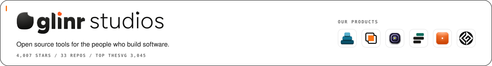
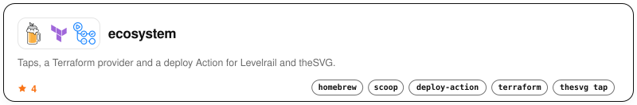
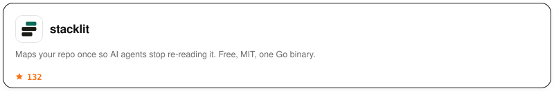
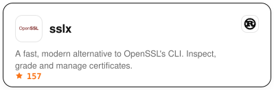
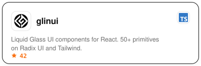
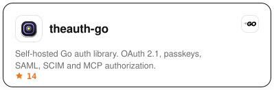
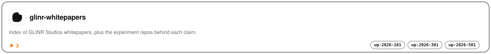

<a href="https://glinr.com"><picture><source media="(max-width: 640px) and (prefers-color-scheme: dark)" srcset="studio/out/hero-dark-mobile.svg" /><source media="(max-width: 640px)" srcset="studio/out/hero-light-mobile.svg" /><source media="(prefers-color-scheme: dark)" srcset="studio/out/hero-dark.svg" /></picture></a> 
<a href="https://glinr.com"><picture><source media="(prefers-color-scheme: dark)" srcset="studio/out/link-glinr-dark.svg" /></picture></a> <a href="https://discord.gg/Ar5pcaZB99"><picture><source media="(prefers-color-scheme: dark)" srcset="studio/out/link-discord-dark.svg" /></picture></a> <a href="https://github.com/glincker"><picture><source media="(prefers-color-scheme: dark)" srcset="studio/out/link-github-dark.svg" /></picture></a> <a href="https://thesvg.org"><picture><source media="(prefers-color-scheme: dark)" srcset="studio/out/link-thesvg-dark.svg" /></picture></a> <a href="https://levelrail.com"><picture><source media="(prefers-color-scheme: dark)" srcset="studio/out/link-levelrail-dark.svg" /></picture></a>

<picture><source media="(max-width: 640px) and (prefers-color-scheme: dark)" srcset="studio/out/header-products-dark-mobile.svg" /><source media="(max-width: 640px)" srcset="studio/out/header-products-light-mobile.svg" /><source media="(prefers-color-scheme: dark)" srcset="studio/out/header-products-dark.svg" /></picture>

<a href="https://github.com/glincker/levelrail"><picture><source media="(max-width: 640px) and (prefers-color-scheme: dark)" srcset="studio/out/tile-levelrail-dark-mobile.svg" /><source media="(max-width: 640px)" srcset="studio/out/tile-levelrail-light-mobile.svg" /><source media="(prefers-color-scheme: dark)" srcset="studio/out/tile-levelrail-dark.svg" /></picture></a><a href="https://github.com/glincker/thesvg"><picture><source media="(max-width: 640px) and (prefers-color-scheme: dark)" srcset="studio/out/tile-thesvg-dark-mobile.svg" /><source media="(max-width: 640px)" srcset="studio/out/tile-thesvg-light-mobile.svg" /><source media="(prefers-color-scheme: dark)" srcset="studio/out/tile-thesvg-dark.svg" /></picture></a>
<a href="https://github.com/glincker/theauth"><picture><source media="(max-width: 640px) and (prefers-color-scheme: dark)" srcset="studio/out/tile-theauth-dark-mobile.svg" /><source media="(max-width: 640px)" srcset="studio/out/tile-theauth-light-mobile.svg" /><source media="(prefers-color-scheme: dark)" srcset="studio/out/tile-theauth-dark.svg" /></picture></a><a href="https://github.com/glincker/ecosystem"><picture><source media="(max-width: 640px) and (prefers-color-scheme: dark)" srcset="studio/out/tile-ecosystem-dark-mobile.svg" /><source media="(max-width: 640px)" srcset="studio/out/tile-ecosystem-light-mobile.svg" /><source media="(prefers-color-scheme: dark)" srcset="studio/out/tile-ecosystem-dark.svg" /></picture></a>

Packaging: <a href="https://github.com/glincker/homebrew-tap">homebrew-tap</a>, <a href="https://github.com/glincker/scoop-bucket">scoop-bucket</a>, <a href="https://github.com/glincker/deploy-action">deploy-action</a>, <a href="https://github.com/glincker/terraform-provider-levelrail">terraform-provider-levelrail</a>, <a href="https://github.com/glincker/homebrew-thesvg">homebrew-thesvg</a>

<picture><source media="(max-width: 640px) and (prefers-color-scheme: dark)" srcset="studio/out/header-tools-dark-mobile.svg" /><source media="(max-width: 640px)" srcset="studio/out/header-tools-light-mobile.svg" /><source media="(prefers-color-scheme: dark)" srcset="studio/out/header-tools-dark.svg" /></picture>

<a href="https://github.com/glincker/stacklit"><picture><source media="(max-width: 640px) and (prefers-color-scheme: dark)" srcset="studio/out/tile-stacklit-dark-mobile.svg" /><source media="(max-width: 640px)" srcset="studio/out/tile-stacklit-light-mobile.svg" /><source media="(prefers-color-scheme: dark)" srcset="studio/out/tile-stacklit-dark.svg" /></picture></a><a href="https://github.com/glincker/sslx"><picture><source media="(max-width: 640px) and (prefers-color-scheme: dark)" srcset="studio/out/tile-sslx-dark-mobile.svg" /><source media="(max-width: 640px)" srcset="studio/out/tile-sslx-light-mobile.svg" /><source media="(prefers-color-scheme: dark)" srcset="studio/out/tile-sslx-dark.svg" /></picture></a>
<a href="https://github.com/glincker/gitincognitor"><picture><source media="(max-width: 640px) and (prefers-color-scheme: dark)" srcset="studio/out/tile-gitincognitor-dark-mobile.svg" /><source media="(max-width: 640px)" srcset="studio/out/tile-gitincognitor-light-mobile.svg" /><source media="(prefers-color-scheme: dark)" srcset="studio/out/tile-gitincognitor-dark.svg" /></picture></a><a href="https://github.com/glincker/featuredrop"><picture><source media="(max-width: 640px) and (prefers-color-scheme: dark)" srcset="studio/out/tile-featuredrop-dark-mobile.svg" /><source media="(max-width: 640px)" srcset="studio/out/tile-featuredrop-light-mobile.svg" /><source media="(prefers-color-scheme: dark)" srcset="studio/out/tile-featuredrop-dark.svg" /></picture></a>

<picture><source media="(max-width: 640px) and (prefers-color-scheme: dark)" srcset="studio/out/header-libs-dark-mobile.svg" /><source media="(max-width: 640px)" srcset="studio/out/header-libs-light-mobile.svg" /><source media="(prefers-color-scheme: dark)" srcset="studio/out/header-libs-dark.svg" /></picture>

<a href="https://github.com/glincker/glinui"><picture><source media="(max-width: 640px) and (prefers-color-scheme: dark)" srcset="studio/out/tile-glinui-dark-mobile.svg" /><source media="(max-width: 640px)" srcset="studio/out/tile-glinui-light-mobile.svg" /><source media="(prefers-color-scheme: dark)" srcset="studio/out/tile-glinui-dark.svg" /></picture></a><a href="https://github.com/glincker/glin-profanity"><picture><source media="(max-width: 640px) and (prefers-color-scheme: dark)" srcset="studio/out/tile-glin-profanity-dark-mobile.svg" /><source media="(max-width: 640px)" srcset="studio/out/tile-glin-profanity-light-mobile.svg" /><source media="(prefers-color-scheme: dark)" srcset="studio/out/tile-glin-profanity-dark.svg" /></picture></a><a href="https://github.com/glincker/theauth-go"><picture><source media="(max-width: 640px) and (prefers-color-scheme: dark)" srcset="studio/out/tile-theauth-go-dark-mobile.svg" /><source media="(max-width: 640px)" srcset="studio/out/tile-theauth-go-light-mobile.svg" /><source media="(prefers-color-scheme: dark)" srcset="studio/out/tile-theauth-go-dark.svg" /></picture></a>

<picture><source media="(max-width: 640px) and (prefers-color-scheme: dark)" srcset="studio/out/header-curated-dark-mobile.svg" /><source media="(max-width: 640px)" srcset="studio/out/header-curated-light-mobile.svg" /><source media="(prefers-color-scheme: dark)" srcset="studio/out/header-curated-dark.svg" /></picture>

<a href="https://github.com/glincker/awesome-selfhosted-ai"><picture><source media="(max-width: 640px) and (prefers-color-scheme: dark)" srcset="studio/out/tile-awesome-selfhosted-ai-dark-mobile.svg" /><source media="(max-width: 640px)" srcset="studio/out/tile-awesome-selfhosted-ai-light-mobile.svg" /><source media="(prefers-color-scheme: dark)" srcset="studio/out/tile-awesome-selfhosted-ai-dark.svg" /></picture></a><a href="https://github.com/glincker/claude-code-marketplace"><picture><source media="(max-width: 640px) and (prefers-color-scheme: dark)" srcset="studio/out/tile-claude-code-marketplace-dark-mobile.svg" /><source media="(max-width: 640px)" srcset="studio/out/tile-claude-code-marketplace-light-mobile.svg" /><source media="(prefers-color-scheme: dark)" srcset="studio/out/tile-claude-code-marketplace-dark.svg" /></picture></a><a href="https://github.com/glincker/ableton-skills"><picture><source media="(max-width: 640px) and (prefers-color-scheme: dark)" srcset="studio/out/tile-ableton-skills-dark-mobile.svg" /><source media="(max-width: 640px)" srcset="studio/out/tile-ableton-skills-light-mobile.svg" /><source media="(prefers-color-scheme: dark)" srcset="studio/out/tile-ableton-skills-dark.svg" /></picture></a>

<picture><source media="(max-width: 640px) and (prefers-color-scheme: dark)" srcset="studio/out/header-research-dark-mobile.svg" /><source media="(max-width: 640px)" srcset="studio/out/header-research-light-mobile.svg" /><source media="(prefers-color-scheme: dark)" srcset="studio/out/header-research-dark.svg" /></picture>

<a href="https://github.com/glincker/glinr-whitepapers"><picture><source media="(max-width: 640px) and (prefers-color-scheme: dark)" srcset="studio/out/tile-glinr-whitepapers-dark-mobile.svg" /><source media="(max-width: 640px)" srcset="studio/out/tile-glinr-whitepapers-light-mobile.svg" /><source media="(prefers-color-scheme: dark)" srcset="studio/out/tile-glinr-whitepapers-dark.svg" /></picture></a>

Experiments: <a href="https://github.com/glincker/wp-2026-101-backup-restore-testing">wp-2026-101-backup-restore-testing</a>, <a href="https://github.com/glincker/wp-2026-301-dns-failover-ttl-testing">wp-2026-301-dns-failover-ttl-testing</a>, <a href="https://github.com/glincker/wp-2026-501-zero-downtime-migrations-testing">wp-2026-501-zero-downtime-migrations-testing</a>

<picture><source media="(max-width: 640px) and (prefers-color-scheme: dark)" srcset="studio/out/header-community-dark-mobile.svg" /><source media="(max-width: 640px)" srcset="studio/out/header-community-light-mobile.svg" /><source media="(prefers-color-scheme: dark)" srcset="studio/out/header-community-dark.svg" /></picture>

More repositories: <a href="https://github.com/glincker/commitweave">commitweave</a>, <a href="https://github.com/glincker/geo-audit-action">geo-audit-action</a>, <a href="https://github.com/glincker/geokit">geokit</a>, <a href="https://github.com/glincker/glinrdock">glinrdock</a>, <a href="https://github.com/glincker/glinweb">glinweb</a>, <a href="https://github.com/glincker/json-to-typescript">json-to-typescript</a>, <a href="https://github.com/glincker/palrun">palrun</a>, <a href="https://github.com/glincker/sentinel">sentinel</a>, <a href="https://github.com/glincker/stacklit-action">stacklit-action</a>

<picture><source media="(max-width: 640px) and (prefers-color-scheme: dark)" srcset="studio/out/footer-dark-mobile.svg" /><source media="(max-width: 640px)" srcset="studio/out/footer-light-mobile.svg" /><source media="(prefers-color-scheme: dark)" srcset="studio/out/footer-dark.svg" /></picture>

Logos from <a href="https://thesvg.org">theSVG</a>

